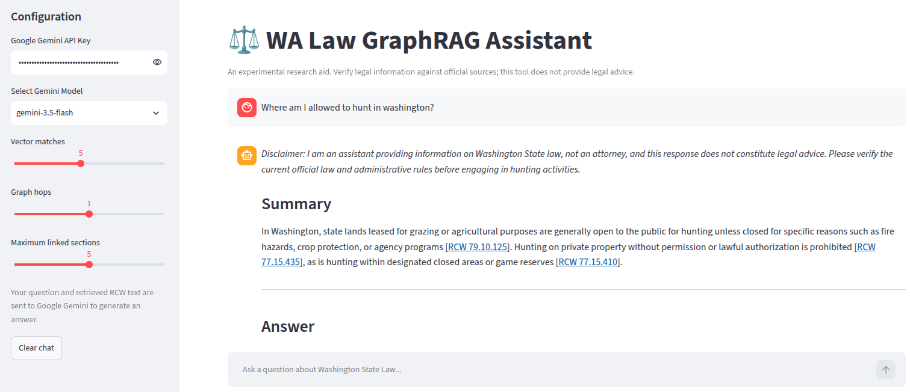

# Washington RCW GraphRAG

An experimental question-answering app for Washington State Revised Code (RCW).
It retrieves RCW sections using vector similarity, expands results through
selected graph relationships, and asks Google Gemini to summarize and answer
from the retrieved text.



*Example app screenshot. Verify all legal information and citations against
current official sources.*

This is a research prototype, not legal advice. The crawler currently uses an
unofficial RCW mirror; verify answers and citations against current official
Washington State sources.

## Quick start

### Requirements

- Python 3.12 or newer
- [`uv`](https://docs.astral.sh/uv/)
- A Google Gemini API key for answer generation
- NVIDIA GPU is optional. The configured PyTorch CUDA 12.6 build supports this
  project’s GTX 970 use case; embedding can also run on CPU.

Run commands below from the repository root.

### Install dependencies

```bash
uv sync
```

### Crawl the RCW source

The crawl output defaults to `rcw_data/`:

```bash
uv run python src/rcw_graph_rag/data_ingest_crawler.py
```

For a small test crawl, limit the number of chapter pages:

```bash
uv run python src/rcw_graph_rag/data_ingest_crawler.py --limit-chapters 5
```

See all crawler options with:

```bash
uv run python src/rcw_graph_rag/data_ingest_crawler.py --help
```

### Build the vector and graph store

By default, this uses the Washington-law sentence-transformer embedder:

```bash
uv run rcw-graph-rag build rcw_data rcw_db
```

This downloads the embedding model from Hugging Face on first use. To build
with the lightweight local hash embedder instead:

```bash
uv run rcw-graph-rag build rcw_data rcw_db --embedder hash
```

The hash embedder is useful for smoke tests, but is not semantically equivalent
to the sentence-transformer model. Rebuild the database if changing embedders;
query and build must use the same recorded embedding configuration.

### Run the app

Set `GEMINI_API_KEY` in the environment or enter the key in the app sidebar:

```bash
export GEMINI_API_KEY="your-api-key"
uv run streamlit run src/rcw_graph_rag/frontend.py
```

The default store location is `rcw_db/`. To use a different database directory,
set `RCW_DB_DIR` before launching the app:

```bash
export RCW_DB_DIR="/path/to/rcw_db"
```

Questions and retrieved RCW text are sent to Google Gemini for response
generation. Do not enter confidential or sensitive information.

### Test retrieval without the frontend

```bash
uv run rcw-graph-rag query rcw_db "What does Washington law say about public records requests?"
```

The CLI accepts `-k` to set the number of vector matches, `--hops` to set graph
traversal depth, and `--where` for an optional LanceDB filter expression.

## Architecture

```text
wa-law.org or offline HTML
          |
          v
data_ingest_crawler.py
          | titles.json, chapters.json, sections.jsonl, edges.jsonl
          v
graph-store build
          |                         |
          v                         v
LanceDB section vectors      NetworkX graph.pkl
          \                         /
           \                       /
            graph-store retrieval
                     |
                     v
       Streamlit frontend + Gemini API
```

- [Package architecture and data flow](src/rcw_graph_rag/README.md)
- [Crawler implementation](src/rcw_graph_rag/data_ingest_crawler.py)
- [Graph store and retrieval implementation](src/rcw_graph_rag/graph_store.py)
- [Streamlit app](src/rcw_graph_rag/frontend.py)

The Streamlit file watcher is disabled in `.streamlit/config.toml` because it
triggered noisy tracebacks while inspecting Transformers' optional image
processing modules. Restart the app manually after changing code.

## Generated files

- `rcw_data/` contains crawler output and its HTML cache.
- `rcw_db/` contains the LanceDB table, serialized NetworkX graph, and metadata.

Both directories are generated locally and can be large. The crawler output is
needed to rebuild the store; the built store is needed to run the frontend.
They are intentionally Git-ignored, so cloning this repository does not include
the data or database. Each user creates them on their own device by running the
crawl and build commands above. The crawler accesses the source website when run;
respect its terms, rate limits, and applicable data-use requirements.

Local `.env` files and Streamlit secrets are also Git-ignored. Never commit API
keys or other credentials.
